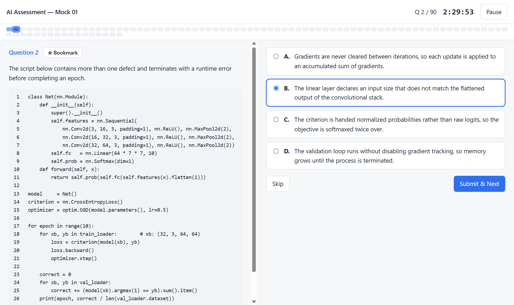
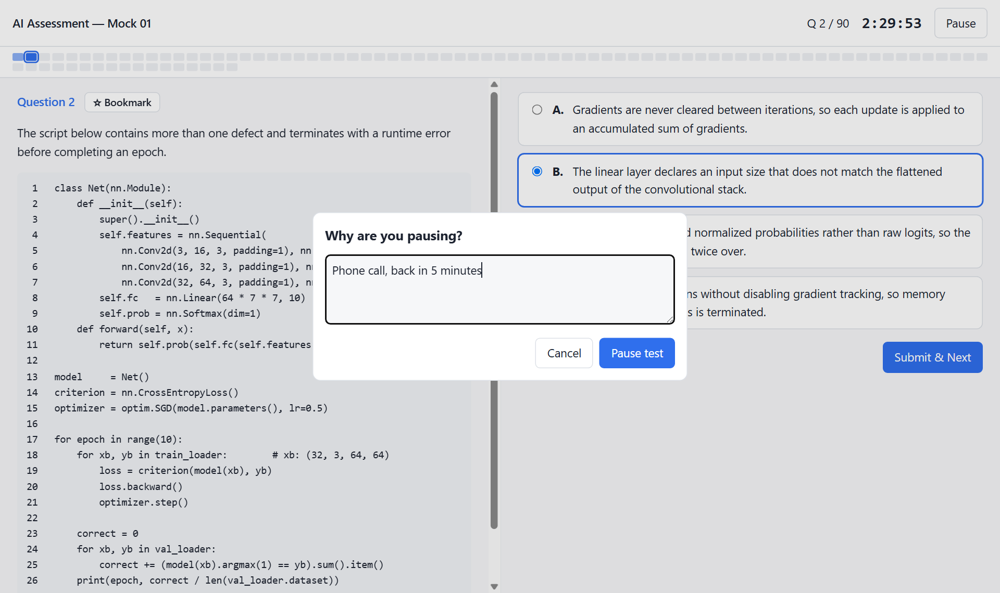
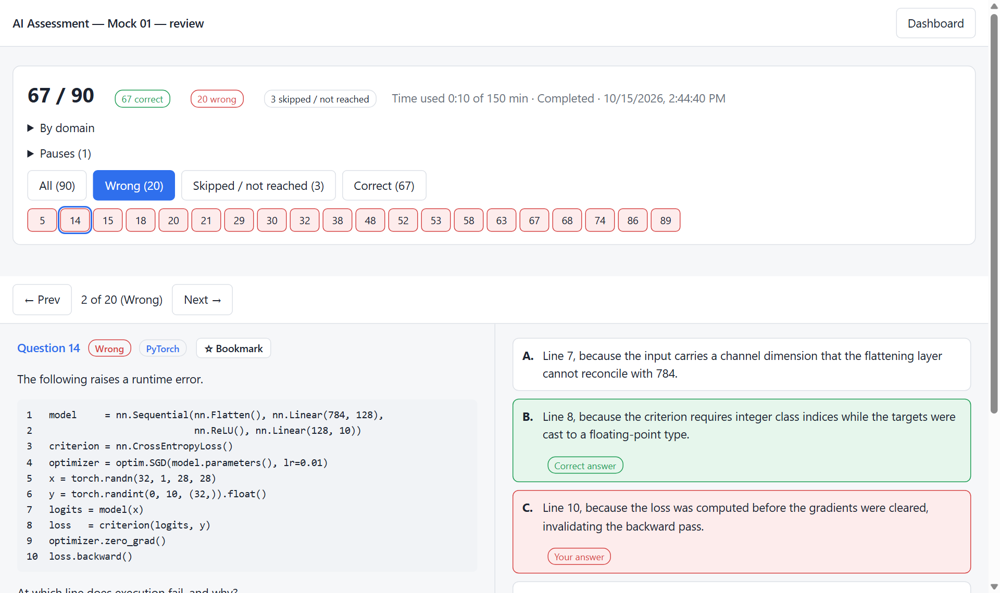

<div align="center">

# Fair MCQ

**Write multiple-choice mock exams that can't be gamed, then take them under real exam conditions.**

[](LICENSE)


[](https://github.com/Gabbar888/fair-mcq/commits)



</div>

This repo has two parts:

1. **Principles and a Claude skill** for writing good single-answer MCQs: questions that need real knowledge, not test-taking tricks.
2. **A local exam app** that runs those papers timed, forward-only, with a full review afterwards.

---

## Why this exists

I built this to prepare for an AI assessment: **90 questions, 150 minutes, one correct answer out of four, +1 / 0 marking, and no going back** to a question once you skip or submit it.

Practice papers made with AI turned out to have a serious flaw. One paper was scored **80/90 by simply picking the longest option** whenever unsure — that trick worked on 90% of the questions. The correct answers were on average 27% longer than the wrong ones, because each one was written as a full explanation while the wrong ones were bare claims. Hedging words (*typically, may*) showed up only in correct answers, and absolute words (*always, never*) clustered in wrong ones.

None of that is about the subject. It's about how the options were written. So I wrote down the rules that stop it, and built an app to practise under the real format.

---

## Core principles

The full rule set, written as instructions you can hand straight to an AI, is in **[general_principles.md](general_principles.md)**. In short:

### A. Options must not give the answer away
- **Length parity.** All four options within ±4 words; correct and wrong options the same length on average.
- **Strip the correct answer to its claim.** It says *which*, not *why*. The *why* goes in the explanation.
- **Put the reasoning in the wrong options.** Each distractor carries a plausible mechanism that leads somewhere false.
- **Spread hedges and absolutes.** *May, typically, always, never* appear in correct and wrong options alike.
- **Aim tricks at chance, not zero.** "Pick the longest" and "pick the shortest" should each work about 25% of the time — never-shortest is as exploitable as always-longest.

### B. Questions must need real knowledge
- **Hide the key fact.** Never state it in the stem; bury it in a realistic scenario, table or code block.
- **Two passes.** Write the question, then rewrite it specifically to defeat reading strategy.
- **No reasoning-only questions, no niche trivia.** Test understanding of standard behaviour, not memorised quirks.

### C. Every answer must be correct
- **Compute numerical answers in code** before writing the key — writing keys from intent once shipped three wrong answers in one paper.
- **Exactly one correct option.** Check every question for a second valid answer.
- **Explanations cover both sides:** why the right answer is right and why each tempting wrong one is wrong.

### D. The paper must feel like the real thing
- **Balanced answer letters** (about N/4 each, no run of four), assigned by random shuffle, never by formula.
- **Difficulty from reading load and time pressure,** not obscure topics. A well-prepared candidate should need ~90% of the time.
- **Spread heavy questions across topics, cover each topic's full width, and never recycle questions.**

---

## The AI exam builder skill

[.claude/skills/ai-exam-builder/](.claude/skills/ai-exam-builder/) is a complete, real example of these principles turned into a [Claude skill](https://docs.claude.com/en/docs/claude-code/skills), built for the 11-domain AI assessment above (statistics, ML, deep learning, NLP, computer vision, LLMs, RAG and more).

If you open this repo in Claude Code, the skill is available automatically. Try:

```
Topic 6, 20 questions
Make me a combined exam, start with topic 1
Audit mock_03.md for gameable options
```

It's specific to that exam. To build your own, **write your own skill or prompt that follows [general_principles.md](general_principles.md)**, using this one as a reference.

| What | Where in the example skill |
|---|---|
| Workflow, two modes, non-negotiables | [SKILL.md](.claude/skills/ai-exam-builder/SKILL.md) |
| Question and option rules, worked example | [references/authoring.md](.claude/skills/ai-exam-builder/references/authoring.md) |
| Assembly, reading load, audit thresholds | [references/assembly.md](.claude/skills/ai-exam-builder/references/assembly.md) |
| Exam file format | [references/format.md](.claude/skills/ai-exam-builder/references/format.md) |
| Syllabus and coverage (AI-specific) | [references/subtopics.md](.claude/skills/ai-exam-builder/references/subtopics.md) |
| Checks: format, option bias, reading load, letter balance | [scripts/](.claude/skills/ai-exam-builder/scripts/) |

---

## Making your own mock exams

1. **Define your exam:** topics, questions per topic, time limit.
2. **List common topics and question types** from past papers or anything you know about the exam.
3. **Give your AI** [general_principles.md](general_principles.md) and that list.
4. **Generate topic by topic,** one file per topic.
5. **Assemble** the blocks into one paper and rebalance answer letters.
6. _(Optional, to practise in the app)_ **Save in the [exam format](.claude/skills/ai-exam-builder/references/format.md)** and drop it into `papers/`.

> **Notes**
> - **Alignment matters most.** The closer the topics match the real exam, the better the paper. My skill keeps these in [confirmed-topics.md](.claude/skills/ai-exam-builder/references/confirmed-topics.md), written after spotting patterns that repeated across sources.
> - **Why topic by topic.** When I used my skill to generate all 90 questions in one go, the quality dropped, so I added a mode that builds the paper one topic at a time.
> - **Follow the format exactly,** or the app can't parse the paper.
> - **Difficulty isn't perfectly tuned.** My papers came out a little harder than the real assessment, but that trained me to read and understand long questions fast, and they helped me clear it. I hope they help with yours.

<details>
<summary><b>Audit thresholds</b></summary>

| Check | Target |
|---|---|
| Correct answer is uniquely the longest | 20–30% of questions (chance is 25%) |
| Correct answer is uniquely the shortest | 20–30% |
| Average word gap, correct vs wrong options | within ±1 word |
| Average length spread within a question | ≤ 3 words |
| Questions with a spread over 5 words | ≤ 3 |
| Correct answer is the only hedged option | 0 |
| Removing options with absolutes leaves only the correct one | 0 |
| Answer letters | N/4 each (±1), no run of 4 |
| Questions that hinge on niche trivia | ≤ 5 |

Reading load used for the 90-question AI paper: 35 questions with code, 17 with a data table, mean stem 47 words, 17 stems over 80 words, ~11,000 words total. Scale to your own paper.

</details>

<details>
<summary><b>Exam file format</b></summary>

The app reads plain Markdown in this shape (full spec: [format.md](.claude/skills/ai-exam-builder/references/format.md)):

````markdown
# My Exam — Mock 01
## 40 questions | 60 minutes | MCQ, single correct

---

**Q1.** Question text. Markdown, tables and code blocks are fine.

A. First option

B. Second option

C. Third option

D. Fourth option

---

# ANSWER KEY

| Q | Ans | Domain |
|---|-----|--------|
| 1 | C | Statistics |

# EXPLANATIONS

**Q1 — C.** Why C is right, and why the tempting wrong options are wrong.

---
````

- Exactly four options per question, each starting `A. ` … `D. ` on its own line.
- The time limit is read from the `## … minutes` line.
- The `Domain` column is optional; it powers the per-topic breakdown and filters.
- Explanation headings must be `**Q<n> — <letter>.**` (with an em dash), or explanations won't show in review.

</details>

---

## The exam app

### Run it

Needs only **Python 3** — no packages to install.

```bash
python server.py
```

Then open **http://127.0.0.1:8000**.

### What it does

| Pause asks for a reason | Review shows where you went wrong |
|---|---|
|  |  |

| | |
|---|---|
| **Real exam conditions** | Timed, forward-only. Skip or submit — no going back. Questions on the left, options on the right, a progress strip showing where you are. |
| **Pause with a reason** | Pausing asks why, stops the timer and hides the question until you resume. Reasons are logged with your result. |
| **Safe against accidents** | Refresh or close the tab and the test resumes where you left off. The timer keeps running while the tab is closed, like a real exam. |
| **Full review** | Score, correct / wrong / skipped counts, per-topic breakdown, pause log. Filter to wrong answers only and jump between them, with your answer, the correct one and the explanation side by side. |
| **Bookmarks** | Star any question during a test or in review. |
| **Custom practice** | Build a test from bookmarked, wrong, skipped or unreached questions across any papers, filtered by topic. You see only tags, never the question text, while choosing. Set your own timer. |
| **Your own papers** | Upload a `.md` file from the dashboard or drop it into `papers/`. |

### Your data stays yours

Attempts are saved to `results/` and bookmarks to `bookmarks.json`, both on your machine and both git-ignored. A fresh clone starts empty.

---

## Included papers

All in [papers/](papers/), written with the AI exam builder skill:

- **`mock_01.md` – `mock_08.md`** — full papers, 90 questions, 150 minutes
- **`topic_01_statistics.md`, `topic_05_ml_fundamentals.md`, `topic_09_computer_vision.md`** — single-topic practice sets

---

## Project structure

```
├── server.py                    # local server: parses papers, saves results
├── static/                      # the app (HTML, CSS, JS)
├── papers/                      # exam papers (.md)
├── general_principles.md        # MCQ writing rules, ready to hand to an AI
├── docs/                        # screenshots
└── .claude/skills/ai-exam-builder/
    ├── SKILL.md                 # the example skill
    ├── references/              # rules, syllabus, format, assembly
    └── scripts/                 # validation and audit scripts
```

---

## License

[MIT](LICENSE) © Gabbar888. Free to use, change and share — just keep the license notice.
